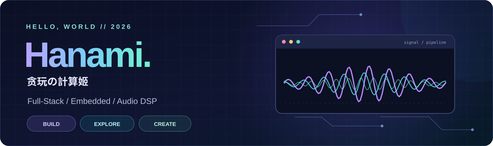
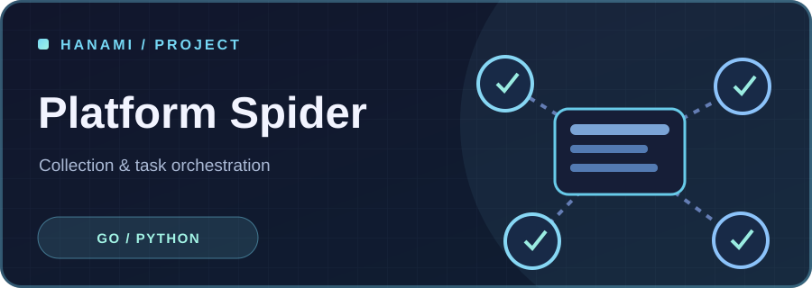
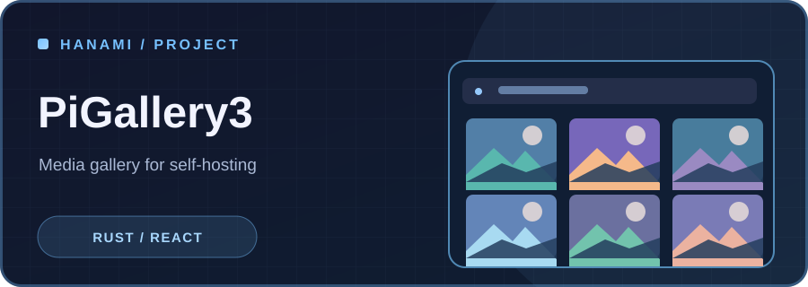
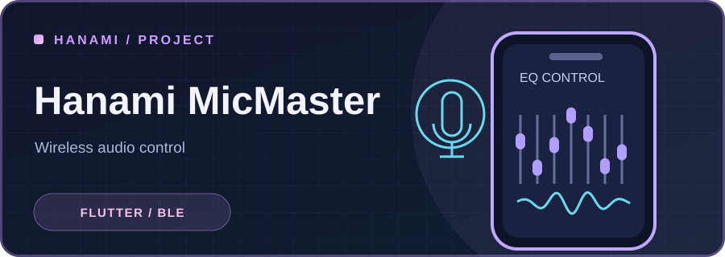
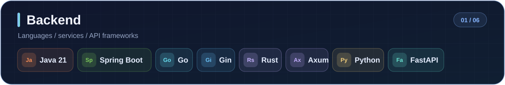
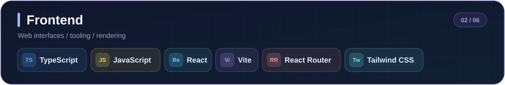
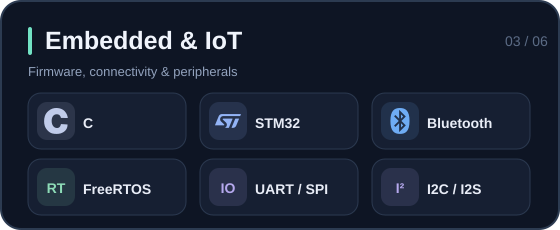
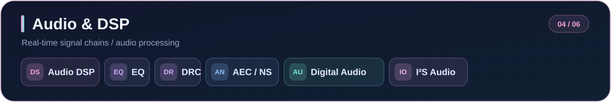
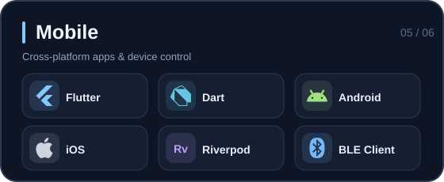
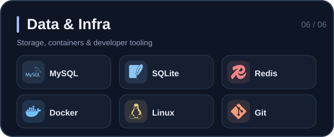

 

**From firmware to full-stack systems.**

用代码连接硬件与数字世界，构建有用、可靠且易于维护的产品。

[**技术博客**](https://hanami-docs.vercel.app/) &nbsp; · &nbsp; [**代表项目**](#selected-work) &nbsp; · &nbsp; [**技术栈**](#tech-stack) &nbsp; · &nbsp; [**GitHub 活动**](https://github.com/Hanami1216?tab=overview)

---

## About Me

我是一名关注 **全栈工程、嵌入式系统与数字音频处理** 的开发者。喜欢在系统约束下做架构设计，也喜欢将设备驱动、通信协议、应用服务与前端交互串成完整产品。

| Full-Stack Engineering | Embedded & IoT | Audio & Media |
| :--- | :--- | :--- |
| 业务平台 · API · SSR · 数据建模 · 部署 | MCU · RTOS · BLE · 通信协议 · 驱动 | Audio DSP · EQ · 无线音频 · 媒体处理 |

**Engineering Philosophy:** Simplicity · Performance · Reliability · Maintainability

## Selected Work

真实项目中的工程探索。项目图仅作为主题插画，不代表实际产品截图。

<table>
<tr>
<td width="50%" valign="top">

### Hanami Mall

**工厂 B2B / B2C 商城系统**

面向工厂直销与电商场景的独立业务平台，涵盖商品管理、多语言 SSR、RFQ 询报价、订单与运营后台。采用模块化单体架构。

<code>Java 21</code> <code>Spring Boot 4</code> <code>React</code> <code>MySQL</code>
</td>
<td width="50%" valign="top">

### Platform Spider

**多平台采集与下载工作台**

围绕多平台适配、账号隔离、任务调度、并行下载与 SSE 事件流设计的自动化工具链。

<code>Go</code> <code>Gin</code> <code>Python</code> <code>React</code>
</td>
</tr>
<tr>
<td width="50%" valign="top">

### PiGallery3

**轻量级 NAS 照片 / 视频图库**

目录优先的媒体管理方案：媒体索引、游标分页、虚拟图库、全文搜索、缩略图与按需视频转码。

<code>Rust</code> <code>Axum</code> <code>React</code> <code>SQLite</code>
</td>
<td width="50%" valign="top">

### Hanami MicMaster

**BLE 音频设备控制 App**

跨平台蓝牙控制应用，围绕多硬件协议适配、设备连接、EQ、音效、灯光与状态同步实现软硬件协同。

<code>Flutter</code> <code>Riverpod</code> <code>BLE</code> <code>Audio DSP</code>
</td>
</tr>
</table>

### More Engineering

| Project | Focus |
| :--- | :--- |
| **MVsilicon BP10xx DSP** | 蓝牙音频 SoC 固件、ADC / DAC、I²S、设备控制协议、音效处理 |
| **MVsilicon BP26xx DSP** | 双核音频平台、音源模式、音频框架与驱动层 |
| **[Hanami Web Serial](https://github.com/Hanami1216/hanami-web-serial-Public)** | 浏览器串口通信、EQ 参数和设备调试 |
| **Hanami DockerCompose** | Docker Compose 环境编排与自托管实践 |
| **[HanamiLink](https://github.com/Hanami1216/HanamiLink)** | 设备互联相关应用 |
| **[Algorithm Practices](https://github.com/Hanami1216/Algorithm_pratices)** | 算法与数据结构实践 |

## Tech Stack

采用与横幅一致的深色主题，技术领域按卡片分组。图形素材全部由此仓库托管。

## Currently Exploring

- **System Architecture** — 模块化单体、API 设计与性能优化。
- **Embedded Audio** — 实时 DSP、自适应音频算法与无线音频设备。
- **AI Engineering** — Agent、工具调用、开发自动化。
- **Self-Hosting** — NAS、容器化与轻量媒体服务。

## GitHub Activity

贡献记录和仓库动态以 [GitHub 原生统计页面](https://github.com/Hanami1216?tab=overview) 为准，不显示未经验证的外部计数器。

---

**Build useful things. Keep them simple.**

[GitHub](https://github.com/Hanami1216) · [Blog](https://hanami-docs.vercel.app/)

