

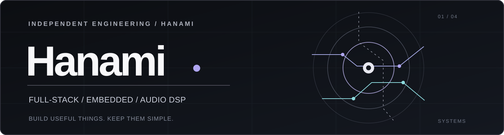

<h1>贪玩の計算姬</h1>

<strong>Full-Stack Engineer · Embedded Systems · Audio DSP</strong>

从嵌入式固件到完整应用，从通信协议到产品交付。

<a href="https://hanami-docs.vercel.app/">Blog</a>
&nbsp;&nbsp;·&nbsp;&nbsp;
<a href="#selected-work">Selected Work</a>
&nbsp;&nbsp;·&nbsp;&nbsp;
<a href="#technology">Technology</a>
&nbsp;&nbsp;·&nbsp;&nbsp;
<a href="https://github.com/Hanami1216?tab=overview">GitHub Activity</a>

---

## What I Build

关注业务系统、嵌入式设备和数字音频的交汇点。重视代码质量、可维护性与资源效率，希望让软硬件协同真正转化为可用的产品。

| Software | Hardware | Audio & Media |
| :--- | :--- | :--- |
| 业务系统、API、SSR、数据库与部署 | MCU、RTOS、BLE、通信协议与驱动 | 音频 DSP、实时处理、设备控制与媒体系统 |

Engineering principles — Simplicity / Performance / Reliability / Maintainability

## Selected Work

部分工程仍在迭代。以下图片为技术主题示意，并非产品实际界面截图。

<table>
  <tr>
    <td width="50%" valign="top">
      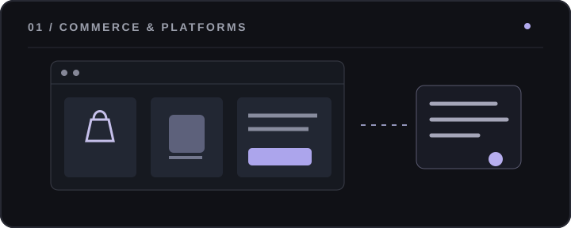
      <h3>Hanami Mall</h3>
      
面向工厂 B2B 直销及 B2C 零售的两套独立平台，涉及多语言 SSR、商品、RFQ 询报价、订单与管理后台。后端采用模块化单体架构。

      
<code>Java 21</code> <code>Spring Boot 4</code> <code>React</code> <code>MySQL</code>

    </td>
    <td width="50%" valign="top">
      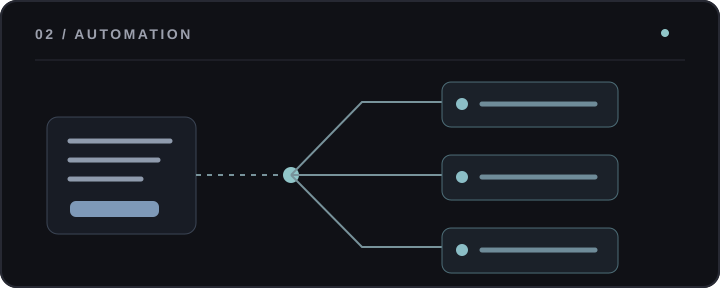
      <h3>Platform Spider</h3>
      
多平台采集和媒体下载工作台。采用任务调度、账号隔离、并行下载与 SSE 事件流，串联网页工作台与 Python 采集工具。

      
<code>Go</code> <code>Gin</code> <code>Python</code> <code>React</code>

    </td>
  </tr>
  <tr>
    <td width="50%" valign="top">
      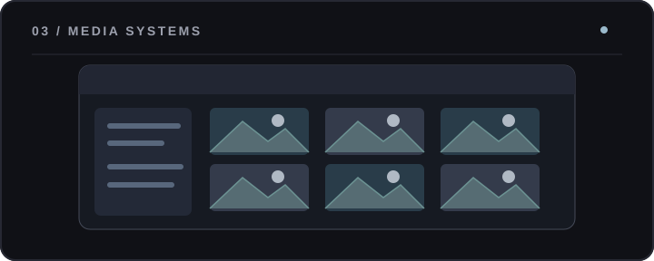
      <h3>PiGallery3</h3>
      
面向 NAS 的照片与视频图库，采用目录优先的数据模型，结合媒体索引、游标分页、虚拟图库、缩略图生成和按需转码。

      
<code>Rust</code> <code>Axum</code> <code>React</code> <code>SQLite</code>

    </td>
    <td width="50%" valign="top">
      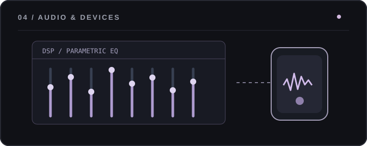
      <h3>Hanami MicMaster</h3>
      
跨平台 BLE 音频控制应用。围绕多协议适配、音频参数、EQ、音效、灯光与设备状态同步构建统一交互层。

      
<code>Flutter</code> <code>Riverpod</code> <code>BLE</code> <code>Audio DSP</code>

    </td>
  </tr>
</table>

### More Engineering

| Engineering | Focus |
| :--- | :--- |
| **MVsilicon BP10xx / BP26xx** | 蓝牙音频 SoC、RTOS、DSP、音频驱动与协议协同 |
| **[Hanami Web Serial](https://github.com/Hanami1216/hanami-web-serial-Public)** | 基于 Web Serial 的 EQ、音量和设备参数调试 |
| **Hanami DockerCompose** | 容器编排、自托管服务与开发环境 |
| **[HanamiLink](https://github.com/Hanami1216/HanamiLink)** | 设备互联相关应用 |
| **[Algorithm Practices](https://github.com/Hanami1216/Algorithm_pratices)** | 算法与编程练习 |

## Technology

实际工程中使用的技术与工具。图标素材随仓库版本管理。

<table>
  <tr>
    <td width="50%">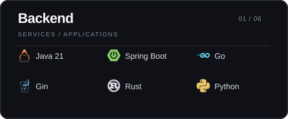</td>
    <td width="50%">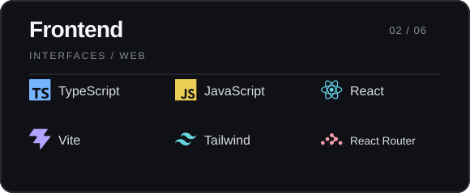</td>
  </tr>
  <tr>
    <td width="50%">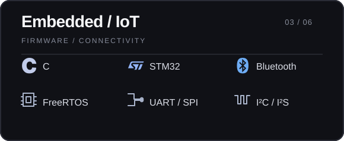</td>
    <td width="50%">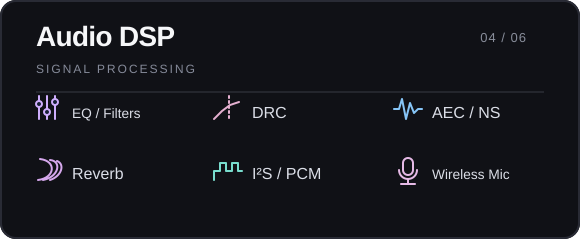</td>
  </tr>
  <tr>
    <td width="50%">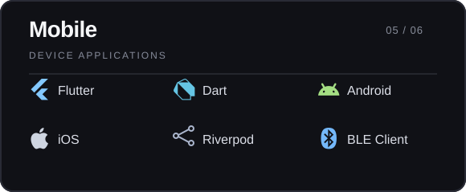</td>
    <td width="50%">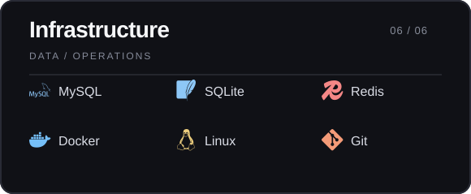</td>
  </tr>
</table>

## Current Focus

**System design** &nbsp; / &nbsp; Java、Go、Rust、模块化架构与性能工程。

**Embedded audio** &nbsp; / &nbsp; 数字音频处理、无线通信与软硬件协同。

**AI engineering** &nbsp; / &nbsp; Agent、自动化工作流与开发者工具。

**Self-hosting** &nbsp; / &nbsp; NAS、Docker、媒体系统与轻量部署。

---

**Build useful things. Keep them simple.**

<a href="https://github.com/Hanami1216">GitHub</a>
&nbsp;&nbsp;·&nbsp;&nbsp;
<a href="https://hanami-docs.vercel.app/">Blog</a>

